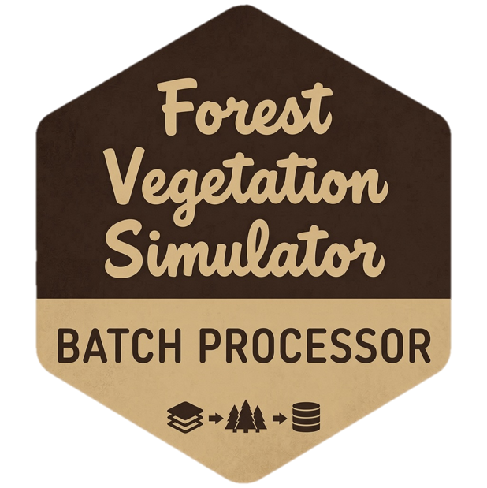

# FVSBatchProcessor

`FVSBatchProcessor` is a Shiny application for configuring and running large Forest Vegetation Simulator (FVS) projects. It connects an FVS-ready SQLite inventory database with keyword component files (KCPs), generates stand- and scenario-specific keyfiles, runs simulations in parallel through `rFVS`, and consolidates the resulting stand databases into scenario-level and project-level outputs.




## Requirements

- R 4.2.0 or newer.
- An FVS installation with the variant binaries needed by your inventory. Installing the R packages does not install these binaries. On Tab 4, set **FVS Bin Path** to their directory; the default is `C:/FVS/FVSSoftware/FVSbin`.
- An FVS-ready SQLite inventory database, including paired stand and tree initialization tables. The default stand table is `FVS_STANDINIT`; the corresponding tree table is `FVS_TREEINIT`. For another stand table, the app derives the tree table name by replacing `StandInit` with `TreeInit` (case-insensitive).
- The stand table must include `STAND_ID`, `STAND_CN`, a grouping column (or `GROUPS`), and valid `VARIANT` codes for simulation (for example, `BM`, not `FVSbm`). Both initialization tables need `STAND_ID`. Column-name matching for these identifiers is case-insensitive. Preserve/grow and original-year modes also require valid `INV_YEAR` values.
- A catalog of keyword component files (KCPs), including output keywords configured to produce exactly one SQLite `.db` output per stand run.
- Read access to the inventory and KCPs, and write access to the project root. **Create New Grouping Column** also requires write access to the input database because it adds a column to the selected stand table. Back up the input database before using that feature.

Run the app locally with access to the project files and installed FVS binaries. The Browse dialogs select paths on the machine running R, not on a remote browser's machine. Generated keyfiles use Windows-style paths; cross-platform FVS execution has not been verified by this documentation review.

## Install

```r
install.packages("remotes")
remotes::install_github("codydangerfield-usfs/FVSBatchProcessor")
```

`rFVS` is a required dependency declared in `Imports` and `Remotes`. The installation above resolves it from the USDA Forest Service GitHub repository, along with the other required R packages. If it needs to be installed separately, use:

```r
remotes::install_github(
	"USDAForestService/ForestVegetationSimulator-Interface",
	subdir = "rFVS"
)
```

<br clear="right">

## Run

```r
library(FVSBatchProcessor)
setwd("C:/path/to/FVS_Project_Folder") # Replace with your project directory.
fvsRunBatch()
```

The working directory at launch supplies the initial **Root Folder Path**; it can also be changed in the app. Use `fvsRunBatch(launch.browser = FALSE)` to suppress automatic browser launch. Additional arguments are forwarded to `shiny::runApp()`; see `?fvsRunBatch` for details.

## Prepare a project

The conventional layout allows automatic detection of a single `.db` or `.sqlite` inventory in **Inputs** and a top-level folder with **KCP** in its name. Otherwise, select the database and KCP directory explicitly on Tab 1.

```text
FVS_Project/
	Inputs/
		inventory.db
	KCP_Catalog/
		01_Global/
			global.kcp
		02_Calibration/
			calibration.kcp
		03_Prescriptions/
			treatment.kcp
		04_Outputs/
			output.kcp
```

Place KCP files directly inside first-level category subfolders, not directly in the catalog root or nested more deeply. The sorted category folders determine KCP stacking order; use zero-padded prefixes to make that order explicit. Within a category, files are ordered by name. `ALL` stacks every KCP in that category into a run; it does not create separate runs.

## Workflow

1. **Global Parameters:** confirm the root, inventory database, KCP directory, and stand table, then click **Scan Directories & Connect DB**. Select a direct database grouping column, or enable **Use GROUPS** to parse categories from the FVS `GROUPS` field. Exclude groups as needed. The optional grouping-column tool modifies the source database.
2. **KCP Lookup Table:** configure one row per group/scenario. **Auto-Populate Combinations** creates the cross-product of the selected KCP columns for the selected groups. Scenario names must be unique. Naming uses `GROUP_CODE` plus the selected **Scenario Columns**; with no selection it falls back to a Prescription-like column, or to `GROUP_CODE_NG` if none exists. You may edit names manually. Export/import `.xlsx` workbooks or import `.csv` files; legacy `.xls` workbooks are not supported. Keep the `GROUP_CODE` header and identifiers intact; prefer the exported workbook for codes with leading zeros because CSV/Excel type conversion can change them. Click **Save KCP Scenarios & Build Manifest** before proceeding. Re-save after lookup or database-context changes, and in each new app session; an existing manifest alone does not activate the job queue.
3. **Create Keyfiles:** choose simulation cycles, cycle interval, inventory-year mode, and generation cores, then click **Generate Stand Keyfiles**. Reset mode overrides the simulation inventory year without rewriting the source inventory years. Preserve/grow mode uses each stand's `INV_YEAR` and adds bridge cycles to the common start year, followed by the requested regular cycles; the common year must not precede any queued inventory year, and bridge plus regular cycles cannot exceed 40. Original-year mode starts each stand at its database inventory year without bridge growth. Variant-default intervals are 5 years for SN, NC, OC, and OP, and 10 otherwise; mixed defaults use 10 years.
4. **Run rFVS Engine:** verify **FVS Bin Path**, choose execution cores, and click **Execute Parallel rFVS Engine**. Test mode executes one stand per group/scenario (the lowest numeric `STAND_ID` where possible); keyfile generation still covers the full queue. Without overwrite, a stand run is reused when its directory already contains exactly one `.db` file; this is a file-presence check, not a check that results match the current KCPs or parameters. Use **Force Overwrite Specific Scenarios** (or `ALL`) after changing inputs for an existing scenario. Overwrite deletes existing `.db` and `.out` files for the queued stand runs before rerunning. Back up results that must be retained.
5. **Consolidate Outputs:** merge the available stand databases into group/scenario databases, then into a timestamped master database. Consolidation replaces existing group/scenario merged databases. It uses the full configured queue, not just the test-mode subset; check run status before treating the master as complete.

Each processing stage has its own core setting. Keyfile generation defaults to at most 8 cores; execution and consolidation default to 75% of detected cores (rounded down), capped at 40 and with a minimum of 1.

## Generated files

Under the selected project root, the app creates:

```text
rFVS_Runs/
	KCP_Lookup_Table.xlsx
	KCP_Lookup_Options.csv
	KCP_AddFile_Manifest.csv
	logs/
	<GROUP_CODE>/
		<Scenario>/
			fvs_<STAND_ID>/
				run.key
				<FVS output database>.db
Outputs/
	<GROUP_CODE>/
		<Scenario>/
			FVSOut_<Scenario>.db
	FVS_Out_<YYYYMMDD_HHMMSS>.db
```

Stand output database names are controlled by your KCPs, not fixed by the app. Failed stand runs write `fvs_runtime_error.log` in the stand directory. Consolidation errors are recorded in `merge_errors.log` within the group/scenario output directory and `full_project_merge_errors.log` in **Outputs** when those errors occur.


## Project Layout

- [R/app_globals_utils.R](R/app_globals_utils.R): global defaults and utility helpers
- [R/app_ui.R](R/app_ui.R): Shiny UI definition and in-app guidance
- [R/app_server.R](R/app_server.R): server logic
- [R/fvsRunBatch.R](R/fvsRunBatch.R): exported app launcher
- [man/fvsRunBatch.Rd](man/fvsRunBatch.Rd): installed launcher help
- [inst/www/](inst/www/): packaged static assets

The repository's [scripts/](scripts/) directory contains standalone LiDAR classification utilities, not steps in the FVS Shiny workflow. They require `houghPrimitives` and `lidR` separately (not package dependencies), use machine-specific input/output paths that must be edited before execution, and assume US survey feet. Review each script's detection settings before use.

