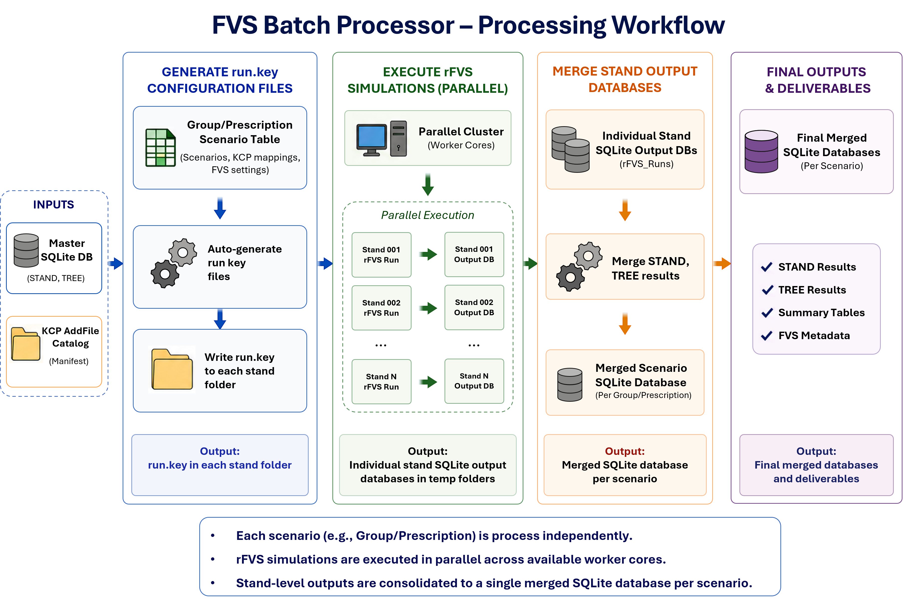

# FVSBatchProcessor

`FVSBatchProcessor` is a Shiny application for configuring and running large Forest Vegetation Simulator (FVS) projects. It connects an FVS-ready SQLite inventory database with keyword component files (KCPs), generates stand- and scenario-specific keyfiles, runs simulations in parallel through `rFVS`, and consolidates the resulting stand databases into scenario-level and project-level outputs.


### Install

```r
install.packages("remotes")
remotes::install_github("codydangerfield-usfs/FVSBatchProcessor")
```

`rFVS` is a required dependency and is declared in `Remotes`, so it will be installed automatically from USDA Forest Service when installing this package from GitHub.

<br clear="right">

## Run

```r
library(FVSBatchProcessor)
setwd("C:/path/to/FVS_Project_Folder") # Replace with your project directory.
fvsRunBatch()
```




### Workflow Summary

1. **Global Parameters**
	- **Link Input Database:** Connect to your FVS-ready SQLite database.
	- **Define Groups:** Specify a grouping column to organize stands for each FVS run.
2. **KCP Lookup Table**
	- **Configure Runs:** Create a KCP lookup table to generate Group/Prescription-specific scenarios using the interactive interface or by downloading, editing, and uploading the mapped Excel spreadsheet based on your KCPs.
3. **Create Keyfiles**
	- **Create Keyfiles:** Generate standalone FVS `.key` configuration files with all specified scenarios on a per-stand basis, natively staged for parallel processing.
4. **Run rFVS Engine**
	- **Execute Scenarios:** Run rFVS instances concurrently across user-specified compute cores.
	- **Note:** A stand run is reused when its directory already contains exactly one `.db` file. This does not verify that its results match the current inputs. After changing KCPs or parameters for an existing scenario, select it in **Force Overwrite Specific Scenarios** on Tab 4. Overwrite deletes existing `.db` and `.out` files for queued stand runs before rerunning.
5. **Consolidate Outputs**
	- **Consolidate Results:** Once all scenarios are configured and executed, consolidate stand-level outputs into scenario-specific databases (one per unique Group/Prescription run), then merge those into a single master database.

### KCP Folder Organization

Users must organize their `.kcp` files into categorical subfolders within their designated KCP directory (e.g., **KCP_Catalog**). These subfolders dictate the configuration combinations available for building scenarios.

Importantly, the alphabetical/numerical order of these subfolders dictates the sequence in which the KCP files are appended and read by FVS. We strongly recommend using numbered prefixes (e.g., `01_Global`, `02_Calibration`, `03_Prescriptions`, `04_Outputs`) to explicitly control this load order. Ensure your output-generating KCP folder is specified last (numbered highest) so its instructions are executed after all other parameters.

### Folder Structure & Expected Locations

Below is the recommended folder structure for organizing your project and running the FVS Batch Processor.

In this workflow, your R working directory becomes the project root and is used as the **Root Folder Path** (e.g., `FVS_BatchProcessing`).

Inside that folder, the app expects an `Inputs` folder with a single input database and a folder with `KCP` in its name (for example, `KCP_Catalog`). If the FVS project directory is set up this way, the app auto-detects both the input database and KCP catalog. During processing, `rFVS_Runs` and `Outputs` are created automatically. `rFVS_Runs` stores individual stand-level run outputs per scenario, and `Outputs` stores consolidated scenario databases plus the final master database.

```text
FVS_BatchProcessing
├── Inputs
│   └── AllBKNF_Combined.db
├── KCP_Catalog
│   ├── 01_Global
│   │   └── Global_rFVS.kcp
│   ├── 02_Calibration
│   │   ├── Group_A_GrowthCalib.kcp
│   │   └── Group_B_GrowthCalib.kcp
│   ├── 03_Prescriptions
│   │   ├── Rx01_TC01.kcp
│   │   ├── Rx01_TC02.kcp
│   │   ├── Rx02_TC01.kcp
│   │   └── Rx02_TC02.kcp
│   └── 04_Outputs
│       └── outputDB.kcp
├── rFVS_Runs
│   ├── Group_A
│   │   └── Group_A_Rx01_TC01
│   │       └── fvs_<Stand_ID>
│   │           ├── out.db
│   │           ├── run.key
│   │           └── run.out
│   └── Group_B
│       └── Group_B_Rx01_TC01
│           └── fvs_<Stand_ID>
│               ├── out.db
│               ├── run.key
│               └── run.out
└── Outputs
	 ├── Group_A
	 │   └── Group_A_Rx01_TC01
	 │       └── FVSOut_Group_A_Rx01_TC01.db
	 ├── Group_B
	 │   └── Group_B_Rx01_TC01
	 │       └── FVSOut_Group_B_Rx01_TC01.db
	 └── FVS_Out_<YYYYMMDD_HHMMSS>.db
```

## App Setup

- `R/app_globals_utils.R`: global defaults and utility helpers
- `R/app_ui.R`: Shiny UI definition
- `R/app_server.R`: server logic
- `R/fvsRunBatch.R`: exported app launcher
- `inst/www/`: packaged static assets

